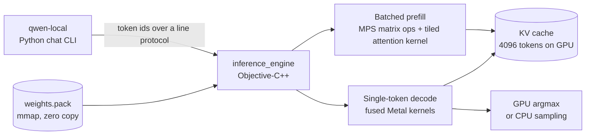

# Qwen Metal

A from-scratch LLM inference engine for Apple Silicon. It runs Qwen2.5-0.5B-Instruct on the GPU using hand-written Metal compute kernels and Objective-C++, with no ML framework in the inference path, and matches MLX's decode speed while producing identical tokens.

```text
$ ./qwen-local --chat --stats
You: What is the capital of France?
Assistant: The capital of France is Paris.

You: And of Italy?
Assistant: The capital of Italy is Rome.

[timing] prompt=0.1ms native=70.5ms first_token=22.1ms decode≈144.5 tok/s
[cache] common=33 delta=14
```

## Highlights

- **Framework-free inference.** Every transformer operation (projection, RMS norm, RoPE, grouped-query attention, MLP, argmax) is a Metal compute kernel written for this project.
- **Decode speed on par with MLX.** 129–143 tokens/s against MLX's 126–139 tokens/s on the same model and machine.
- **Verified correct.** Greedy output matches the MLX reference token for token (24/24 in the automated check).
- **23 ms to first token** in multi-turn chat, by keeping the KV cache alive across turns and prefilling only the new part of the prompt.
- **57 ms engine startup**, using a packed, memory-mapped weight file that Metal reads with zero copies.
- **Seven backends** behind one interface, including INT8 and INT4 quantized paths, for measuring speed against quality.
- **Tested and measured.** 72 automated tests, an end-to-end verifier, a benchmark suite with an MLX reference, a quantization evaluator, and per-kernel microbenchmarks.

## Benchmarks

Measured on an Apple M1 Pro with `benchmark_suite.py --include-mlx` (64 generated tokens, median of 3 runs).

| Context (tokens) | Engine | Prefill (tokens/s) | Decode (tokens/s) |
| ---: | --- | ---: | ---: |
| 32 | MLX | 509 | 126 |
| 32 | **This engine, FP16** | 165 | **129** |
| 32 | This engine, INT8 | 107 | 142 |
| 128 | MLX | 1520 | 139 |
| 128 | **This engine, FP16** | 611 | **143** |
| 128 | This engine, INT8 | 145 | 151 |
| 512 | MLX | 3049 | 137 |
| 512 | **This engine, FP16** | 1930 | **140** |
| 512 | This engine, INT8 | 147 | 146 |

| Latency | FP16 |
| --- | ---: |
| Native engine startup | 57 ms |
| One-shot command, time to first token | 256 ms |
| Chat turn with cached context, time to first token | 23 ms |

Decode is slightly ahead of MLX. Prompt prefill is still slower than MLX, most visibly on short prompts, and the INT8 backend has no batched prefill yet.

## How it works



- **Chat front end** (`qwen_chat.py`, launched by `qwen-local`): tokenizes with a fast local BPE tokenizer, keeps the native engine running as a persistent process, and streams tokens back as they are generated.
- **Native engine** (`qwen_engine.mm`): owns the Metal pipelines, the weights and the KV cache. In chat it compares each new prompt with what is already cached, keeps the shared prefix, and only processes the rest.
- **Context window**: when a conversation reaches the 4096-token limit, the oldest turns are dropped until about half the window is free, so the cache is rebuilt once and the following turns are fast again. Dropped turns stay in the saved transcript, and `/context` shows current usage.
- **Prefill**: the whole prompt delta is processed in one batch. Prompts of 512 tokens or more switch to a tiled attention kernel with online softmax.
- **Decode**: one token per step through fused kernels (QKV projection, RoPE with cache append, gate/up activation). Attention uses a flash-decoding kernel that scores 32 cached tokens per thread group and merges blocks for long contexts.
- **Sampling**: greedy argmax runs on the GPU; temperature, top-k, top-p and repetition penalty run on the CPU with a seedable generator.
- **Weights**: exported from the Hugging Face model, optionally quantized group-wise to INT8 or INT4, then packed into one page-aligned file that is memory-mapped at startup.

## Quick start

Requirements: an Apple Silicon Mac, Xcode command line tools with the Metal toolchain, and Python 3.10 or newer.

```bash
python3 -m venv venv
venv/bin/pip install -r requirements.txt
venv/bin/python export_weights.py
venv/bin/python quantize_weights.py --bits all
venv/bin/python pack_weights.py --profile fp16
(cd kernel/qwen_kernel/qwen_kernel && ./build_engine.sh)
```

`export_weights.py` downloads `Qwen/Qwen2.5-0.5B-Instruct` and writes FP16 tensors plus the tokenizer files, so nothing is read from the Hugging Face cache afterwards. The quantize step is only needed for the quantized backends. Rerun the pack step whenever the weight files change.

Ask a single question:

```bash
./qwen-local "Explain a transformer KV cache in simple terms."
```

Start an interactive chat:

```bash
./qwen-local --chat
```

Useful options:

| Option | Effect |
| --- | --- |
| `--backend fp16` | Choose a backend (see below) |
| `--stats` | Print timing and cache reuse after each reply |
| `-n 128` | Maximum tokens to generate |
| `--temperature 0.7 --top-p 0.9` | Enable sampling |
| `--save-chat chat.json` | Save the transcript |

Inside the chat, `/help` lists the commands: `/status`, `/backend`, `/tokens`, `/temperature`, `/top-p`, `/top-k`, `/repeat`, `/seed`, `/system`, `/context`, `/history`, `/multi`, `/save`, `/reset`, `/stats`, `/exit`.

## Backends

| Backend | What it is | Status |
| --- | --- | --- |
| `fp16` | Half-precision Metal kernels with batched prefill | Stable, the default |
| `int8` | 8-bit group-quantized weights | Experimental, slightly faster decode |
| `int8-fp16` | INT8 body with an FP16 output head | Experimental |
| `int4` | 4-bit group-quantized weights | Experimental, quality is not reliable |
| `mixed` | INT4 body with an FP16 output head | Experimental |
| `hybrid` | FP16 batched prefill with INT4 decode | Experimental |
| `mps` | Apple MPS matrix operations | Comparison baseline |

## Tests

```bash
venv/bin/python -m unittest discover tests
```

The suite uses only the standard library test runner and takes about 20 seconds.

| File | What it covers |
| --- | --- |
| `tests/test_context.py` | Context window budgeting and trimming of old turns |
| `tests/test_tokenizer.py` | Chat template, special tokens, round trips, and exact agreement with the Hugging Face tokenizer |
| `tests/test_weights.py` | INT8/INT4 quantization error bounds and the packed weight format |
| `tests/test_engine.py` | The native engine: argument errors, deterministic and seeded generation, agreement between backends and kernel variants, KV cache reuse, and recovery from bad requests |

Engine tests are skipped automatically when the engine binary or weights are missing, which is how the GitHub Actions workflow runs them on a machine without a GPU.

## Verification and benchmarking

Run the end-to-end verifier. It rebuilds the engine, then checks generation, the chat wrapper, KV cache reuse, session latency, token agreement with MLX, and benchmark output:

```bash
venv/bin/python verify_engine.py --backend fp16 --compare-tokens 24 --benchmark-tokens 24 --benchmark-contexts 32,128 --benchmark-repeats 1 --session-turns 4 --session-tokens 32 --timeout 240
```

Reproduce the benchmark table:

```bash
venv/bin/python benchmark_suite.py --include-mlx --backends fp16,int8 --contexts 32,128,512 --tokens 64 --repeats 3 --warmups 1
```

Measure how closely the quantized backends follow FP16:

```bash
venv/bin/python quantization_eval.py --backends int8,int8-fp16,int4 --tokens 64
```

Compare a full reply against MLX:

```bash
venv/bin/python compare_chat.py --backend fp16 -n 80
```

### Developer switches

Each optimized path can be turned off to measure it against the version it replaced.

| Switch | Effect |
| --- | --- |
| `QWEN_FLASH_DECODE=0` | Use the earlier fused/blockwise decode attention |
| `QWEN_FUSED_ATTENTION=0` | Use the original three-pass decode attention |
| `QWEN_GROUPED_GQA=0` | Disable paired GQA blocks for long contexts |
| `QWEN_TILED_PREFILL=0` or `--legacy-prefill-attention` | Use score-matrix prefill attention |
| `QWEN_COMBINED_PREFILL=0` | Use separate MPS launches for prefill matrices |
| `QWEN_GPU_TIMING=1` | Print wall time, GPU time and overhead per decode step |
| `QWEN_METAL_SOURCE_DIR=<dir>` | Compile the `.metal` sources at startup instead of loading `default.metallib` |
| `--warmup` | Pre-touch the mapped weights at startup |
| `--no-gpu-warmup` | Skip the chat-mode prefill warmup to expose first-use cost |

## Optimization work

- KV cache reuse for decode and across chat turns
- Batched prefill of only the new part of each prompt
- Zero-copy combined QKV and gate/up prefill matrices
- Fused kernels: QKV projection, RoPE with cache append, gate/up activation
- Flash-decoding attention with per-block online softmax and block merge
- Paired grouped-query attention near the 4096-token limit
- SIMD-group matrix tiled prefill attention for long prompts
- Two-stage GPU argmax
- Packed, page-aligned, memory-mapped weights wrapped directly as Metal buffers
- Backend-specific pipeline loading and a prefill warmup that moves first-use cost out of the first chat turn
- A lightweight tokenizer path that avoids importing Transformers for one-shot commands

## Repository layout

| Path | Contents |
| --- | --- |
| `qwen-local`, `qwen_chat.py` | Chat and one-shot command line front end |
| `kernel/qwen_kernel/qwen_kernel/qwen_engine.mm`, `qwen_engine.h` | The inference engine and its C API |
| `kernel/qwen_kernel/qwen_kernel/main_cli.mm` | Native CLI and persistent server mode |
| `kernel/qwen_kernel/qwen_kernel/kernels.metal`, `optimized_kernels.metal` | Metal compute kernels |
| `export_weights.py`, `quantize_weights.py`, `pack_weights.py` | Weight export, quantization and packing |
| `tests/` | Automated tests |
| `verify_engine.py`, `benchmark_suite.py`, `benchmark_real.py`, `compare_chat.py`, `quantization_eval.py` | Verification and measurement tools |
| `kernel/bench/` | Standalone kernel microbenchmarks |
| `baseline.py`, `benchmark_qwen.py`, `metal_bridge.py`, `qwen_patched.py`, `qwen_test.py`, `bridge.mm`, `inference.mm`, `main.mm` | Early prototypes, kept for history |

## Limitations

- Built for one model. Dimensions, vocabulary size and layer count are fixed for Qwen2.5-0.5B-Instruct.
- The context window is 4096 tokens. Older turns are dropped rather than summarized, so the model forgets them.
- Prefill is slower than MLX, and the quantized backends prefill one token at a time.
- INT4 quantization changes the model's output early; INT8 follows FP16 more closely but is only slightly faster.
- The `mps` backend has no persistent KV cache and recomputes the full prompt each turn.
- The engine tests need an Apple GPU and the weights, so CI only runs the chat template, context and weight-format tests.
- It is a command line tool by design; there is no HTTP server.

This is a learning and systems project, not a replacement for MLX or llama.cpp. Its value is that the whole inference stack is visible and measured: kernels, memory layout, dispatch overhead, cache behavior, startup cost and backend trade-offs.

## License

MIT. See [LICENSE](LICENSE). The model weights are downloaded separately and are covered by Qwen's own license.
